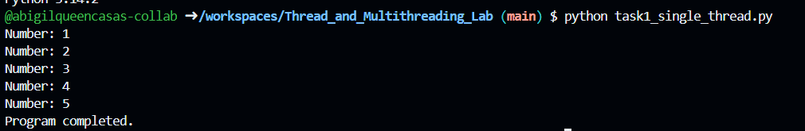
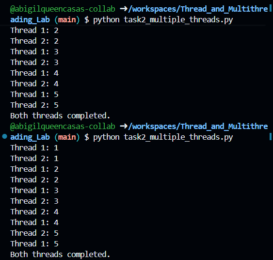
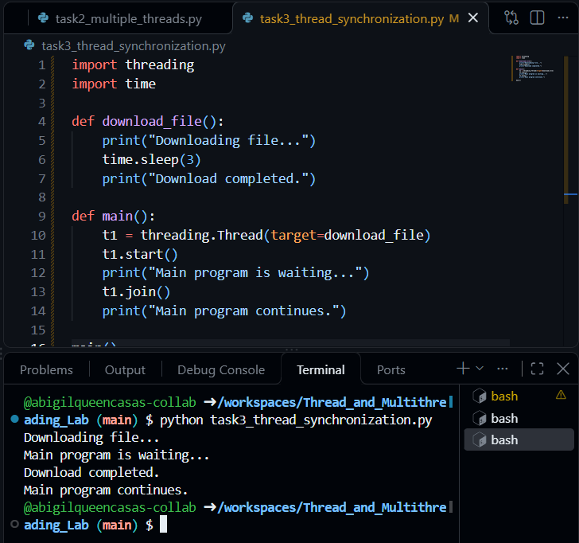
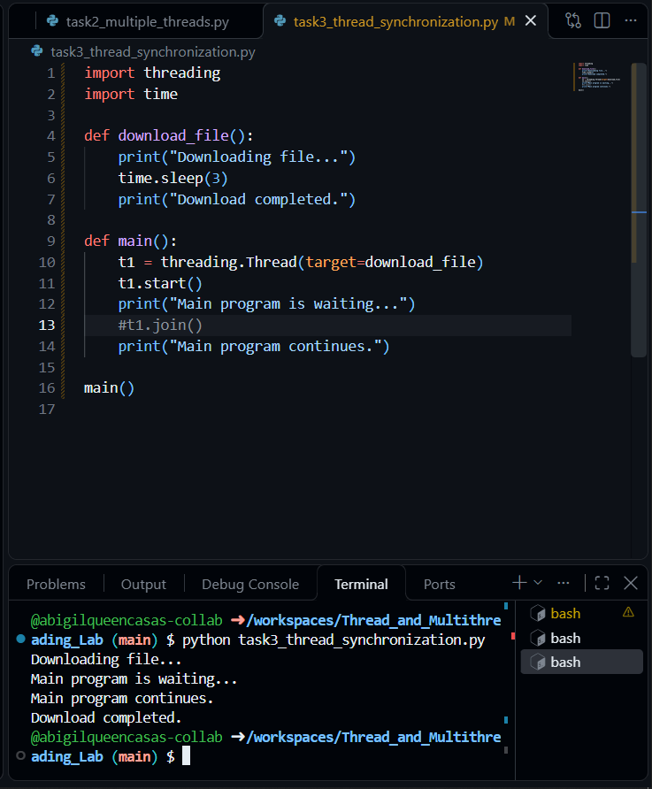
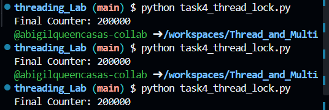

# Threads and Multithreading Laboratory

## Laboratory Description
This laboratory demonstrates thread creation,
multithreading, thread coordination, and
shared-resource management using Python.

## Completed Tasks
1. Single Thread
2. Multiple Threads
3. Thread Synchronization using join()
4. Shared Resource Management using Lock()

## Learning Outcomes
- Create and execute threads.
- Demonstrate concurrent execution.
- Explain thread coordination.
- Apply locks to protect shared resources.

## Repository Files
| File | Description |
|------|-------------|
| task1_single_thread.py | Creating and executing a single thread |
| task2_multiple_threads.py | Running two threads concurrently |
| task3_thread_synchronization.py | Thread synchronization using join() |
| task4_thread_lock.py | Protecting a shared counter using Lock() |

---

## Program Output Screenshots

### Task 1: Single Thread

### Task 2: Multiple Threads

### Task 3: Thread Synchronization
With `join()`:

Without `join()`:

### Task 4: Thread Lock
With `Lock()`:

Without `Lock()`:

---

## Guide Questions and Answers

### Task 1: Single Thread
1. **What is the purpose of `threading.Thread()`?**
   It creates a new thread object that will run the function given in the `target` argument.
2. **What happens when `start()` is executed?**
   The thread begins running its target function concurrently with the main program.
3. **What is the purpose of `join()`?**
   It makes the calling thread (the main program) wait until the thread finishes.
4. **What happens if `join()` is removed?**
   The main program does not wait, so "Program completed." may be printed before the thread finishes its numbers.

### Task 2: Multiple Threads
1. **How many threads are created in the program?**
   Two threads (`t1` and `t2`), in addition to the main thread.
2. **Do the two threads execute independently?**
   Yes. Each thread runs its own function and sleeps independently of the other.
3. **Why might the output order change when the program is executed again?**
   The operating system scheduler decides when each thread runs, so small timing differences can change the order.
4. **What is the difference between sequential and concurrent execution?**
   Sequential execution finishes one task completely before starting the next. Concurrent execution lets multiple tasks make progress during overlapping time periods.

### Task 3: Thread Synchronization Using join()
1. **Why does the main program wait when `join()` is used?**
   `join()` blocks the main thread until the download thread is finished, so the steps happen in the correct order.
2. **What happens when `join()` is removed?**
   The main program continues immediately and may finish before the download thread completes.
3. **In what situations is thread synchronization necessary?**
   When one task depends on the result of another, when a program must wait for a task before continuing, and when threads share data or resources.

### Task 4: Managing Shared Resources Using Thread Locks
1. **What is a shared resource?**
   Data or a resource that multiple threads can access, such as the `counter` variable.
2. **What is a race condition?**
   A situation where the result depends on the unpredictable timing of threads accessing shared data at the same time.
3. **What is the purpose of `threading.Lock()`?**
   It allows only one thread at a time to execute the protected code, preventing simultaneous changes to shared data.
4. **What is a critical section?**
   A section of code that accesses shared data and must not be executed by more than one thread at the same time. In this lab, it is `counter += 1`.
5. **Why is synchronization important when multiple threads access shared data?**
   Without it, threads can overwrite each other's updates, causing lost updates and incorrect results.

**Observation:** When the lock was removed, the final counter was still 200000. The result can vary depending on the Python version and execution environment.

---

## General Questions

1. **What is the difference between a process and a thread?**
   A process is an independent program with its own memory space. A thread is a lightweight unit of execution inside a process, and threads in the same process share its memory.
2. **What are the advantages of using multithreading?**
   Better responsiveness, easier resource sharing, faster creation and context switching than processes, and better use of multicore processors.
3. **How does multithreading improve application responsiveness?**
   Long-running tasks such as downloads run in the background while the main program or user interface stays active.
4. **What is the difference between concurrency and parallelism?**
   Concurrency is managing multiple tasks in overlapping time periods, which can be done on a single core. Parallelism is multiple tasks running at the exact same moment on multiple cores.
5. **Why is a lock necessary when multiple threads access shared data?**
   A lock prevents two threads from modifying the same data at once, which avoids race conditions.
6. **What might happen if a thread is not properly synchronized?**
   Race conditions, lost updates, corrupted or inconsistent data, and unpredictable program results.
7. **Can multiple threads execute simultaneously on a single-core processor? Explain.**
   Not truly simultaneously. A single core runs one thread at a time, but the operating system switches rapidly between threads (time slicing), so they appear to run at the same time.
8. **How does the operating system manage kernel-level threads?**
   The kernel creates, schedules, and context-switches kernel-level threads directly. It keeps track of each thread's state, assigns threads to CPU cores, and handles blocking and waking threads.